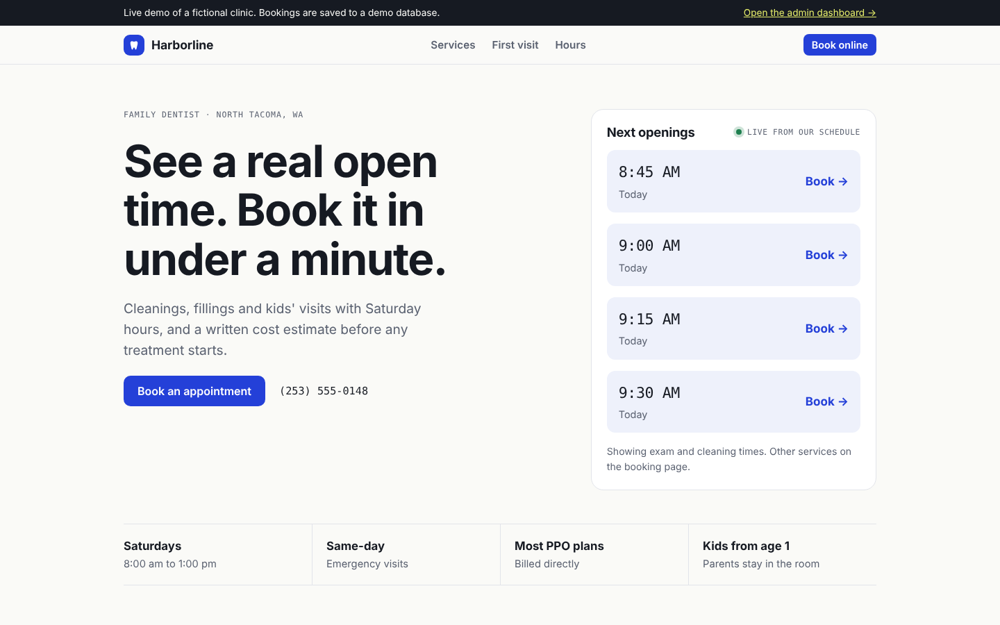
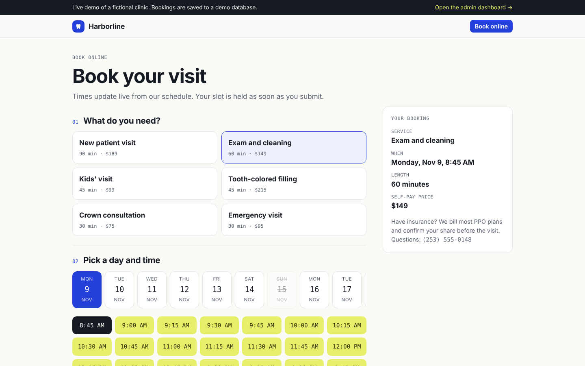
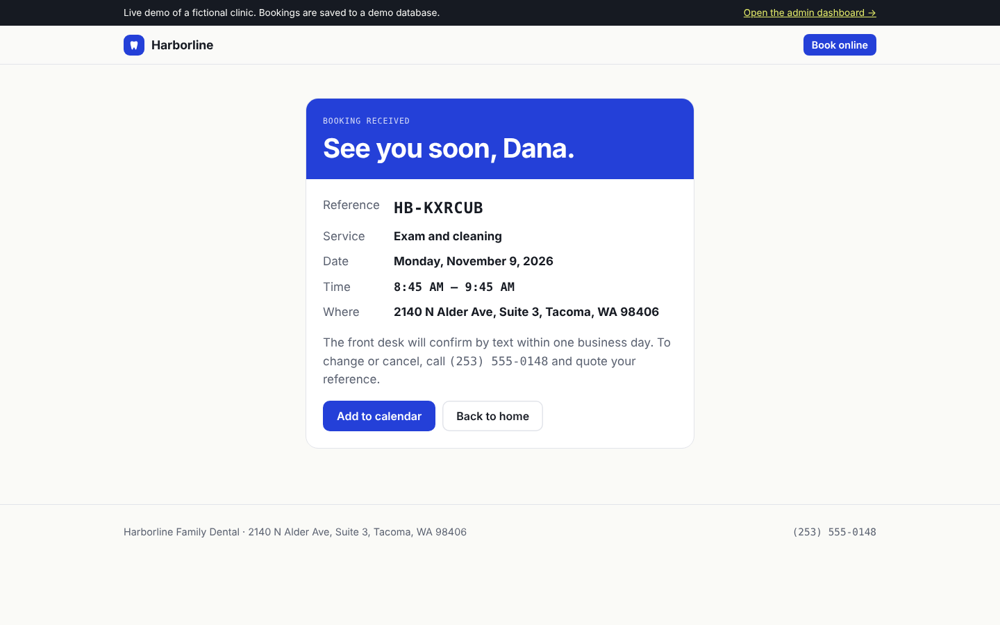
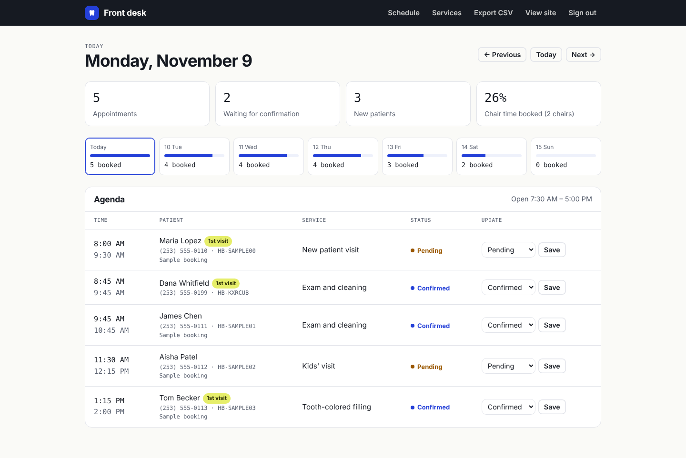
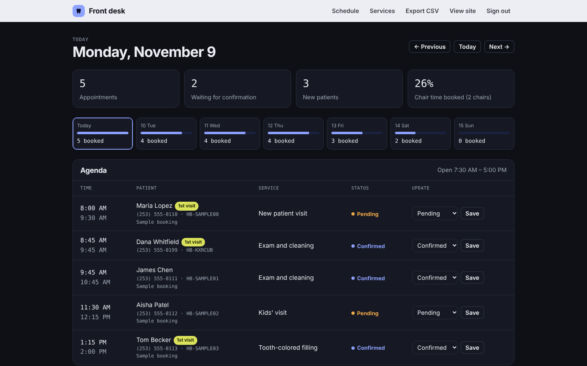

# Harborline Booking

An online booking system for a dental clinic. Patients see real open times and book in under a minute; the front desk manages the day from a password-protected dashboard.

Built with Next.js 14 (App Router), a SQL database through libSQL (SQLite locally, Turso in production) and plain CSS. No paid services are required.

> **Live demo:** _add your Vercel link here after deploying_ · Admin password shown on the sign-in page in demo mode.



| Booking flow | Confirmation |
| --- | --- |
|  |  |

| Front desk dashboard | Dark mode |
| --- | --- |
|  |  |

## Features

**Public site**
- Home page with live "next openings" pulled from the schedule
- Services and self-pay prices from the database, with insurance procedure codes
- Opening hours that highlight today

**Booking**
- Three steps: service, day and time, patient details
- Availability calculated from opening hours, service length, existing bookings and the number of chairs
- Same-day minimum notice and a rolling booking window
- Double-booking protection: each booking re-checks availability inside a database write transaction
- Server-side validation and a spam honeypot
- Confirmation page with a booking reference and an "Add to calendar" (.ics) file

**Front desk dashboard** (`/admin`)
- Day view with appointments, pending confirmations, first-visit patients and chair utilisation
- Seven-day load overview
- Change a booking's status: pending, confirmed, completed, cancelled, no-show
- Edit service prices and lengths, or hide a service from online booking
- Export bookings to CSV (spreadsheet-safe)
- Signed, HTTP-only session cookie; constant-time password check

**Quality**
- Unit tests for the scheduling logic (`npm test`)
- Works on phones, keyboard accessible, automatic dark mode
- Security headers, no tracking, no third-party scripts

## Run it locally

Requires Node.js 18.18 or newer.

```bash
npm install
cp .env.example .env.local      # then edit ADMIN_PASSWORD and SESSION_SECRET
npm run dev
```

Open http://localhost:3000. The database file `local.db` and its tables are created automatically on the first request. The admin dashboard is at http://localhost:3000/admin.

Useful commands:

| Command | What it does |
| --- | --- |
| `npm run dev` | Development server |
| `npm test` | Scheduling logic tests |
| `npm run build && npm start` | Production build |
| `npm run db:reset` | Wipe the local database and seed it again |

## Deploy for free (Vercel + Turso)

1. **Create the database.** Sign up at turso.tech, create a database, and copy its URL (starts with `libsql://`) and an auth token. The free plan is enough for a clinic of this size; check turso.tech/pricing for current limits.
2. **Put the code on GitHub.** Create a new repository and upload this folder (without `node_modules`, `.next` or `.env.local`).
3. **Import into Vercel.** At vercel.com, choose Add New → Project, pick the repository, and add these environment variables:

   | Name | Value |
   | --- | --- |
   | `DATABASE_URL` | Your Turso URL |
   | `DATABASE_AUTH_TOKEN` | Your Turso token |
   | `ADMIN_PASSWORD` | The front desk password |
   | `SESSION_SECRET` | A random string of at least 32 characters |
   | `DEMO_MODE` | `true` for a portfolio demo, `false` for a real clinic |

4. **Deploy.** Vercel builds the site. On the first visit the app creates its tables and starter services automatically.

To use a real clinic's details, change the values in `lib/setup.js` before the first deploy, or edit services from the dashboard afterwards.

## Project structure

```
app/
  page.js                     Home page
  book/                       Booking flow, server action, confirmation, .ics
  admin/login/                Staff sign-in
  admin/(protected)/          Dashboard and services editor (session required)
  api/slots/                  Open times for a service and date (JSON)
  api/admin/export/           CSV export (session required)
lib/
  slots.js                    Availability calculation (pure, unit tested)
  data.js                     Database queries and transactional booking
  setup.js                    Schema and starter data
  auth.js                     Session signing and password check
  validation.js               Input validation (zod)
tests/                        node:test unit tests
```

## Notes

- Times are stored in the clinic's local time zone (`timezone` in the settings table), so availability never shifts with daylight saving or server location.
- `DEMO_MODE=true` shows a demo banner, seeds sample bookings and prints the admin password on the sign-in page. Turn it off for real use.
- For a real clinic, add SMS or email confirmations (for example Twilio or Resend) where the booking is created in `lib/data.js`.
